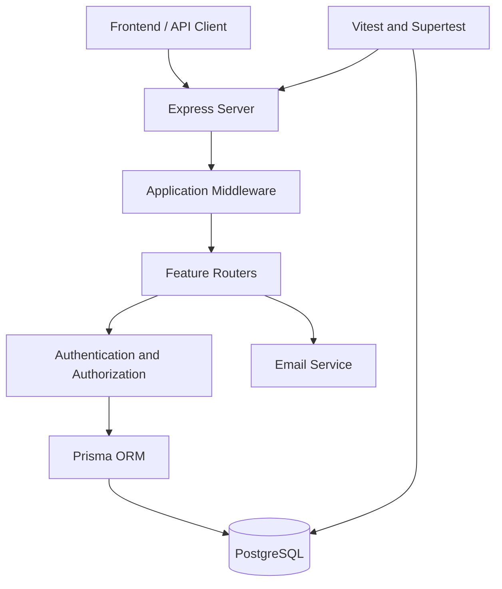

# Community Engagement Hub — Backend

REST API backend built with Node.js, TypeScript, Express 5, Prisma ORM, and PostgreSQL.

## Architecture



The application entry points are `src/app.ts` and `src/server.ts`.

## Technology Stack

- Node.js and TypeScript
- Express 5
- PostgreSQL
- Prisma ORM
- Zod validation
- Argon2 password hashing
- Nodemailer
- Vitest and Supertest

## Project Structure

```text
backend/
├── prisma/
├── src/
│   ├── auth/
│   ├── communities/
│   ├── posts/
│   ├── announcements/
│   ├── notifications/
│   ├── activities/
│   ├── gamification/
│   ├── analytics/
│   ├── lib/
│   ├── test/
│   ├── app.ts
│   └── server.ts
├── docs/
│   └── API_REFERENCE.md
├── package.json
└── tsconfig.json
```

## Feature Modules

| Module         | Responsibility                              |
| -------------- | ------------------------------------------- |
| Authentication | Registration, login, and session management |
| Communities    | Communities, memberships, and roles         |
| Posts          | Posts, comments, and reactions              |
| Announcements  | Community announcements and read tracking   |
| Notifications  | User notifications                          |
| Activities     | Community activity feeds                    |
| Gamification   | Points, badges, and leaderboards            |
| Analytics      | Membership and engagement metrics           |

## API Routes

| Module         | Base path                   |
| -------------- | --------------------------- |
| Authentication | `/api/auth`               |
| Communities    | `/api/communities`        |
| Posts          | `/api/posts`              |
| Announcements  | `/api/announcements`      |
| Notifications  | `/api/notifications`      |
| Activities     | `/api/activities`         |
| Gamification   | `/api/gamification`       |
| Analytics      | `/api/analytics`          |
| Health checks  | `/health`, `/health/db` |

See [`docs/API_REFERENCE.md`](API_REFERENCE.md) for endpoint documentation.

## Setup

### Prerequisites

- Node.js
- PostgreSQL
- Project dependencies
- Environment variables configured

### Install dependencies

```bash
npm install
```

### Environment configuration

Configure `.env` with the required application and database variables.

Use a separate `.env.test` for integration tests. Never commit secrets, tokens, or database credentials.

### Start the development server

```bash
node node_modules/tsx/dist/cli.mjs watch src/server.ts
```

## Testing

The previously recorded test result was 125 passing tests across 9 files. Run the suite again after code changes to verify the current result.

### Run all tests

```bash
node node_modules/vitest/vitest.mjs run
```

### TypeScript type checking

```bash
node node_modules/typescript/bin/tsc --noEmit
```

### Run feature-specific tests

```bash
node node_modules/vitest/vitest.mjs run src/auth
node node_modules/vitest/vitest.mjs run src/communities
node node_modules/vitest/vitest.mjs run src/posts
node node_modules/vitest/vitest.mjs run src/announcements
node node_modules/vitest/vitest.mjs run src/activities
node node_modules/vitest/vitest.mjs run src/gamification
node node_modules/vitest/vitest.mjs run src/analytics
```

## Developer Notes

### Authentication and authorization

- Require authentication for protected routes.
- Verify community membership and role permissions before privileged operations.
- Validate resource ownership and community boundaries.
- Preserve rate limiting on authentication endpoints.

### Validation and errors

- Validate request bodies, query parameters, and path parameters.
- Return appropriate HTTP status codes.
- Do not expose stack traces, credentials, or internal database errors.

### Database

- Use Prisma for database operations.
- Preserve foreign-key and uniqueness constraints.
- Use transactions when related writes must succeed or fail together.
- Apply schema changes through deliberate migrations.

### Test isolation

- Integration tests must use the dedicated test database.
- Verify the target database before destructive operations.
- Never run test cleanup against production data.

### Security

- Keep `.env` and `.env.test` private.
- Never hardcode secrets or tokens.
- Review logs before sharing them externally.

## Documentation Maintenance

When adding or modifying an endpoint, update `docs/API_REFERENCE.md` with its method, path, authentication requirements, headers, parameters, request body, response schema, and error status codes.
